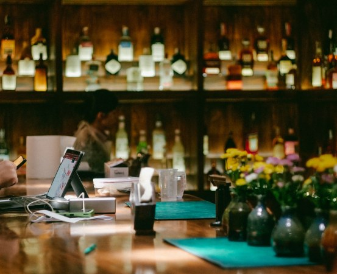

# Spec: House of IRORI Website — Phase 1 (`Home v3B` Static HTML/CSS/JS)

## Objective
Convert the client's Figma design (**House of IRORI - Website**, `file_key: unKDZtWKWErXbWWjttuqWa`, page `Home Final` `494:4`, frame `Home v3B` `494:1203`) into a fast, semantic, pixel-perfect **Static HTML5 / CSS3 / Vanilla JS** codebase for both **Desktop (`1920px`)** and **Mobile (`390px`)** viewports.

The markup is structured with clean, repeatable DOM containers (`data-cms-collection="reviews"`, `data-cms-collection="articles"`) so it can be wired directly to **Strapi Headless CMS** in the next phase without refactoring HTML/CSS.

## Tech Stack
- **Markup:** Semantic HTML5 (`index.html`)
- **Styling:** Modern Vanilla CSS3 (`css/style.css`) using CSS Custom Properties (Design Tokens), CSS Grid, Flexbox, and fluid `clamp()` typography. Zero heavy CSS framework dependencies.
- **Interactivity:** Vanilla ES6+ JavaScript (`js/main.js`), zero runtime dependencies.
- **Typography (Google Fonts):**
  - `Playfair Display` (Regular 400, Medium 500) — Headings, section titles, navigation links
  - `Lora` (Regular 400, Medium 500, SemiBold 600, Bold 700) — Body copy, metadata, footer
  - `Inter` (Regular 400, Medium 500) — Google Review cards UI
- **Design Tokens (Extracted from Figma `node_494_4.json`):**
  - `--bg-cream`: `#F4F1EA` (Story & Latest News background)
  - `--bg-white`: `#FFFFFF` (Level One: The Alley background)
  - `--bg-burgundy`: `#5A2929` (Level Two: The Bar background & Latest News heading)
  - `--bg-dark`: `#0A0A0A` (Reviews/Map & Footer bottom background)
  - `--bg-dark-elevated`: `#141414` (Footer top banner overlay)
  - `--color-espresso`: `#4A3B32` (Primary dark brown text & embossed card fill)
  - `--color-gold`: `#C6A15B` / `#C9A24A` (Gold headings, accents, and `RESERVATIONS` CTA)

## Commands
- **Dev Server:** `python3 -m http.server 8080 --directory /Users/Victor/.gemini/antigravity/scratch/house-of-irori`
- **JS Syntax Check:** `node --check /Users/Victor/.gemini/antigravity/scratch/house-of-irori/js/main.js`
- **Automated Verification Suite:** `node /Users/Victor/.gemini/antigravity/scratch/house-of-irori/tests/verify-home.mjs`
- **Secret Scan:** `git -C /Users/Victor/.gemini/antigravity/scratch/house-of-irori grep -i "figd_" && exit 1 || exit 0`

## Project Structure
```text
/Users/Victor/.gemini/antigravity/scratch/house-of-irori/
├── index.html              → Home v3B page (Desktop 1920px & Mobile 390px responsive)
├── css/
│   └── style.css           → Design tokens, layout, responsive rules (1920px → 390px)
├── js/
│   └── main.js             → Sticky header, mobile drawer, image carousels, card sliders
├── assets/
│   ├── images/             → High-res images exported directly from Figma API
│   └── icons/              → SVG logos, ornaments, arrows, social icons from Figma API
├── tests/
│   └── verify-home.mjs     → Automated DOM, style, and interactive behavior test script
├── CONSTRAINTS.md          → Quality gates & budgets
└── SPEC.md                 → This specification
```

## Code Style
```html
<!-- Clean BEM-style semantic markup with Strapi-ready data attributes -->
<article class="news-card" data-cms-item="article">
  <div class="news-card__media">
    
  </div>
  <div class="news-card__body">
    <time class="news-card__date" datetime="2026-04-14">APRIL 14, 2026</time>
    <h3 class="news-card__title">Why We Work with Spirit, Not Against It</h3>
    <p class="news-card__excerpt">A conversation about respect, slow curation, and why every ingredient has a story to tell...</p>
    <a href="#blog-detail" class="news-card__link">READ MORE <span aria-hidden="true">↗</span></a>
  </div>
</article>
```

## Testing Strategy
- **Static & DOM Tests (`tests/verify-home.mjs`):** Node.js test suite verifying all 10 Figma sections exist, all exported image/SVG assets resolve on disk with non-zero byte size, CSS variables match Figma hex codes, and no Hebrew placeholder text remains.
- **Browser Runtime & Visual Verification (Chrome DevTools MCP):**
  - Render at `1920x1080` (Desktop) and `390x844` (Mobile) against local HTTP server.
  - Verify Sticky Header transition (`Header=Default` → `Header=Scrolled`), Mobile Menu Drawer toggle, `The Alley` & `The Bar` image carousels, `Google Reviews` slider, and `Latest News` slider.
  - Verify zero console/network errors (`list_console_messages`, `list_network_requests`).

## Boundaries
- **Always:** Export real assets from Figma API (`unKDZtWKWErXbWWjttuqWa`), preserve exact typography and color hex codes from Figma, keep `.figma-cache/` out of git commits.
- **Ask first:** Adding any third-party npm library, changing layout structure away from Figma `Home v3B`, or starting the remaining 4 subpages (`Menu`, `Events`, `Blogs`, `Blog Articles`).
- **Never:** Commit Figma Personal Access Tokens to git, leave Hebrew placeholder text in Google Reviews, or use fixed `position: absolute` coordinates that break responsive flow.

## Success Criteria
1. All 10 sections of `Home v3B` (`Stick Header` + `Mobile Header`, `Hero` + `Framed Bartender`, `Hidden in Plain Sight` Story, `The Space Between` Collage, `Level One: The Alley` 50/50 split + slider, `Level Two: The Bar` 50/50 split + slider, `Google Reviews + Map` 50/50 split, `Atmospheric Banner Strip`, `Latest News` 3-card slider, `A Glimpse Inside` + `Footer`) are implemented and match Figma visually at `1920px` and `390px`.
2. All original images and SVG logos/icons are exported directly from Figma API into `assets/` and load with HTTP `200`.
3. Interactive controls (Sticky header on scroll, Mobile menu drawer, Discover the story smooth scroll, Alley/Bar dot carousels, Google Reviews `<`/`>` slider, Latest News `<`/`>` slider) work smoothly with zero console errors.
4. Hebrew placeholder text in Google Reviews is replaced with natural English reviews tailored to House of IRORI.

## Open Questions
- None (all requirements for Phase 1 `Home v3B` confirmed).
